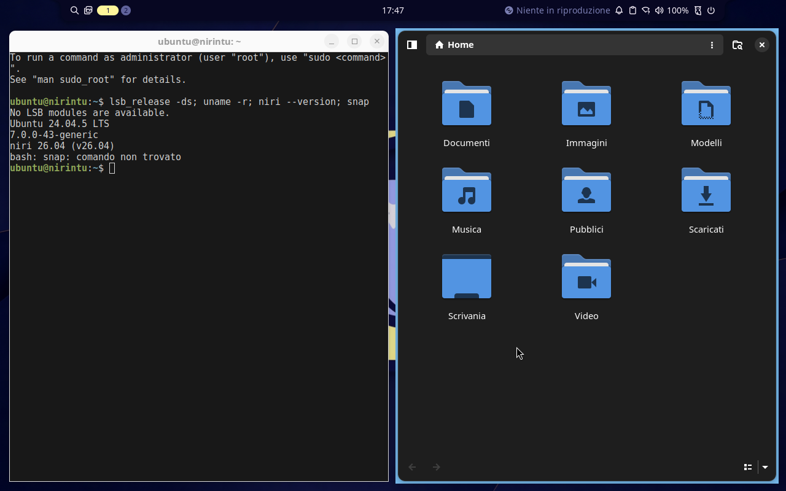
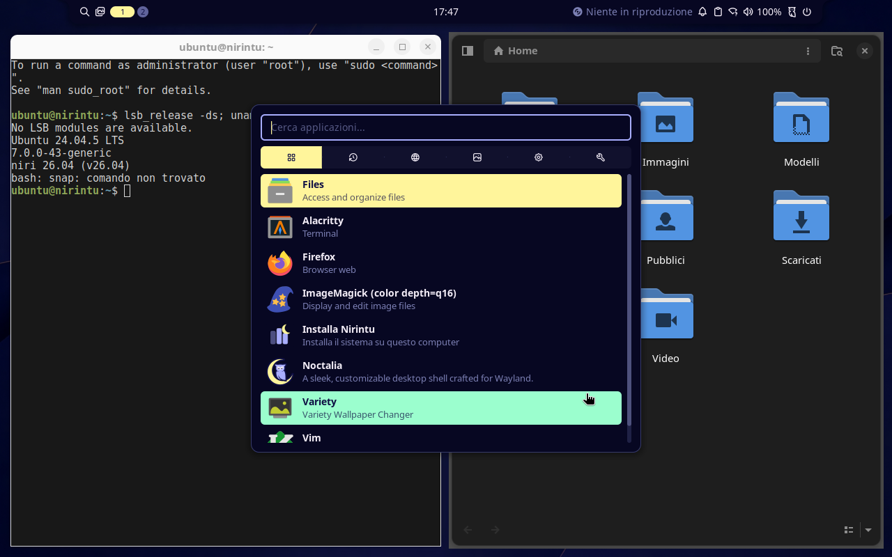
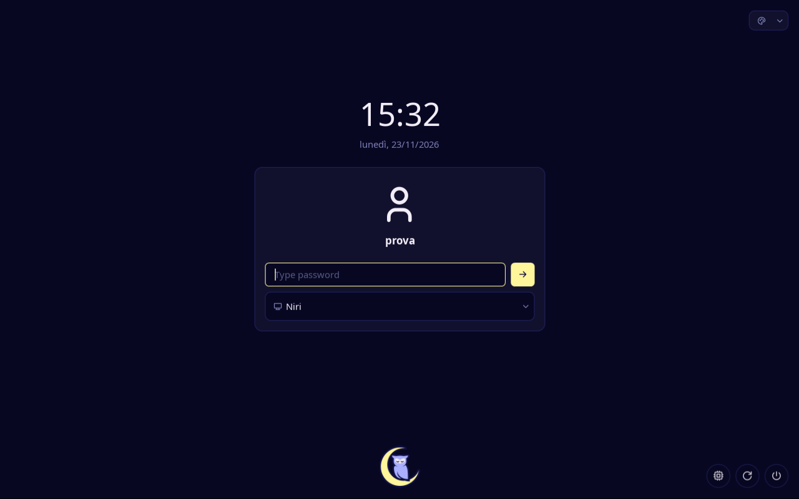
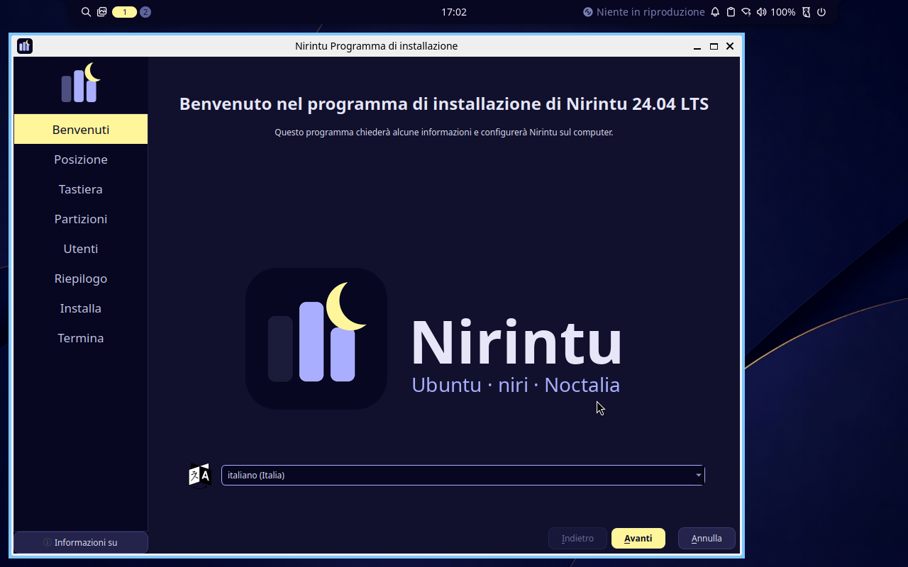
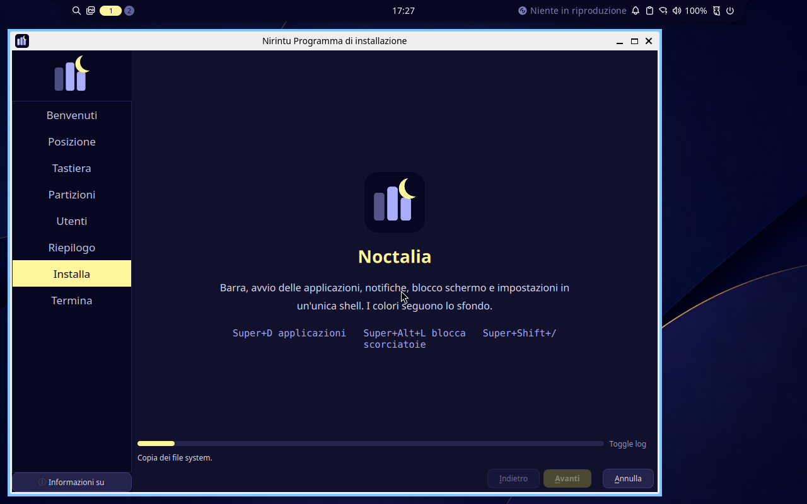
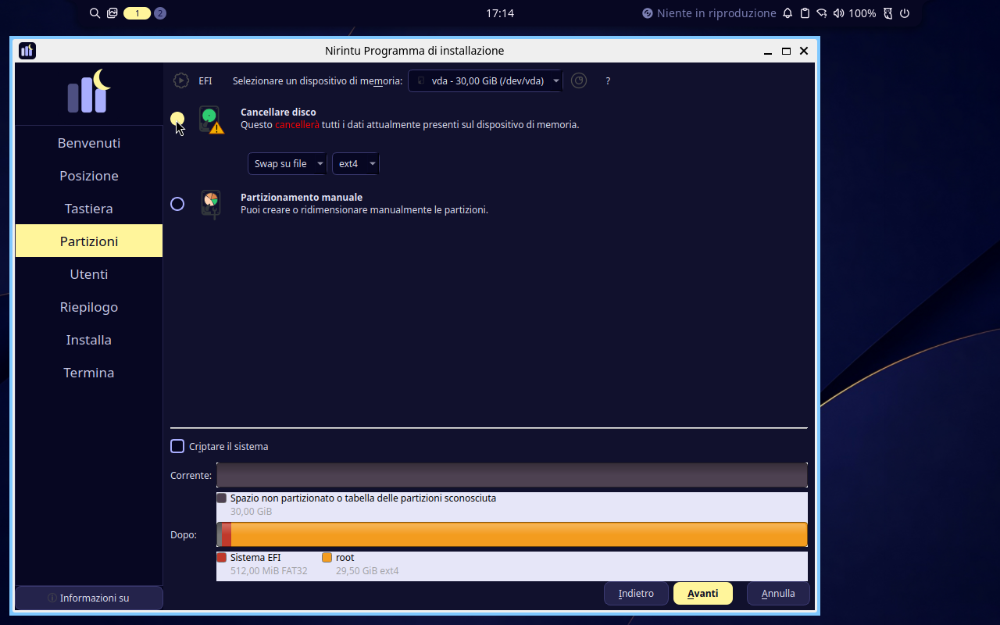
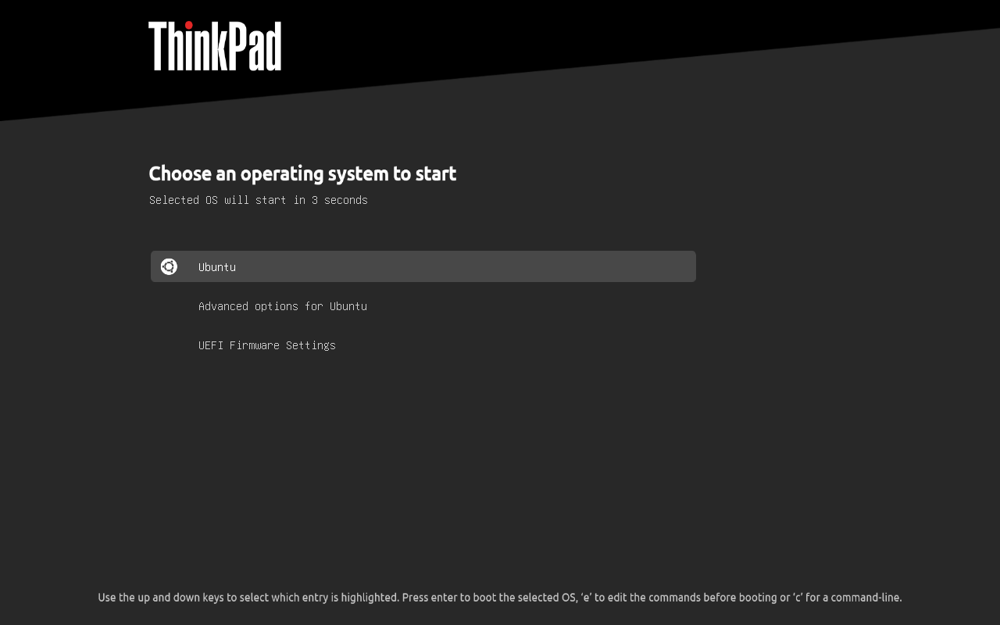

<p align="center">
  
</p>

<h1 align="center">Nirintu</h1>

<p align="center">
  <b>Ubuntu 24.04 LTS with the niri scrollable-tiling compositor and the Noctalia shell. No snap.</b>
</p>

<p align="center">
  <a href="https://github.com/kabronius/nirintu/actions/workflows/release.yml"></a>
  
  
  
  <a href="LICENSE"></a>
</p>



## Why Nirintu

- **Windows in columns.** [niri](https://github.com/niri-wm/niri) places windows side by side on a strip that
  scrolls horizontally: opening a window never squeezes the others.
- **A complete shell.** [Noctalia](https://github.com/kabronius/noctalia) brings the bar, launcher,
  notifications, lock screen, settings and a login screen that share the same colours.
- **Ubuntu underneath.** The 24.04 LTS archive, the HWE kernel and security updates, without snap: apps come as
  `.deb`, Firefox from Mozilla's own repository, everything else from Flathub.
- **Ready for real hardware.** NVIDIA driver with signed modules, Secure Boot, LUKS encryption, dual boot.
- **A boot menu that knows the machine.** The GRUB theme follows the computer's brand: ThinkPad, Legion, ROG,
  Omen, XPS, Framework and more.

## Screenshots

| | |
| --- | --- |
|  |  |
| Noctalia launcher | Login screen |
|  |  |
| Installer | Installation in progress |
|  |  |
| Partitioning, with optional encryption | Boot menu on a ThinkPad |

## What's inside

| | |
| --- | --- |
| Desktop | niri, Noctalia, Noctalia Greeter, Papirus icons, Xwayland for X11 apps |
| Apps | Firefox, Alacritty, Nautilus, Variety, Flatpak with Flathub |
| System | Ubuntu 24.04 LTS, HWE kernel, PipeWire, NetworkManager, Bluetooth |
| Graphics | Mesa for Intel and AMD, NVIDIA 580 with Secure Boot-signed modules |
| Languages | English and Italian |

## Getting Nirintu

Releases publish the sources, the package list and the component versions; the ISO (about 2.5 GB) is built
from this repository with Docker, without root privileges on the host:

```sh
git clone https://github.com/kabronius/nirintu.git
cd nirintu
./build.sh
```

The image lands in `/var/tmp/nirintu/out/` after about an hour on a recent machine. Writing it to a USB stick
(all data on the stick is erased):

```sh
sudo dd if=/var/tmp/nirintu/out/nirintu-24.04.1-amd64.iso of=/dev/sdX bs=4M status=progress conv=fsync
```

The stick boots on UEFI (Secure Boot included) and on older BIOS machines. The live session starts on its own;
**Install Nirintu** in the launcher (`Super+D`) opens the installer.

## First steps

| Keys | Action |
| --- | --- |
| `Super+T` | terminal |
| `Super+D` | launcher |
| `Super+←` / `Super+→` | move between columns |
| `Super+O` | overview of the workspaces |
| `Super+Alt+L` | lock the screen |
| `Super+Shift+/` | all shortcuts |

More apps: `flatpak install flathub <app>`. The boot menu theme can be changed with `nirintu-grub-theme`
(`nirintu-grub-theme list` shows the available themes).

## FAQ

**Why no snap?** Snap packages start slowly, update on their own schedule and duplicate libraries. Nirintu
keeps the system on `.deb` and uses Flathub for the rest; `snapd` is blocked so that no package can pull it in.

**Does it work with Secure Boot?** Yes: the ISO and the installed system boot through Canonical's signed shim
and GRUB, and the NVIDIA modules are signed by Canonical.

**Can it sit next to Windows?** Yes: the installer can install alongside another system, and other installed
systems appear in the boot menu.

**Is it an official Ubuntu flavour?** No. Nirintu is an independent project built on the Ubuntu archive.

## Built with

[Ubuntu](https://ubuntu.com) · [niri](https://github.com/niri-wm/niri) ·
[Noctalia](https://github.com/noctalia-dev/noctalia) ·
[Calamares](https://calamares.io) · [Papirus](https://github.com/PapirusDevelopmentTeam/papirus-icon-theme) ·
[distro-grub-themes](https://github.com/AdisonCavani/distro-grub-themes) ·
[xwayland-satellite](https://github.com/Supreeeme/xwayland-satellite)

## Contributing

How the image is built: [docs/BUILDING.md](docs/BUILDING.md). Making changes and releases:
[CONTRIBUTING.md](CONTRIBUTING.md). History: [CHANGELOG.md](CHANGELOG.md).

## License

Apache-2.0 ([LICENSE](LICENSE)). The Calamares module configuration is derived from
`calamares-settings-lubuntu` (GPL-3.0-or-later); the GRUB themes come from distro-grub-themes (GPL-3.0) and are
shipped in the image with their license.
